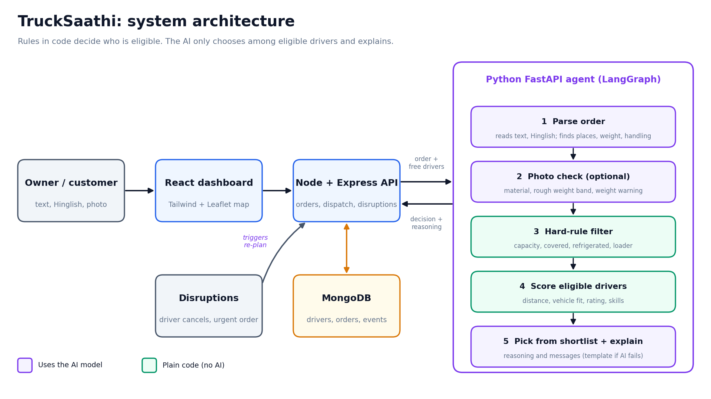
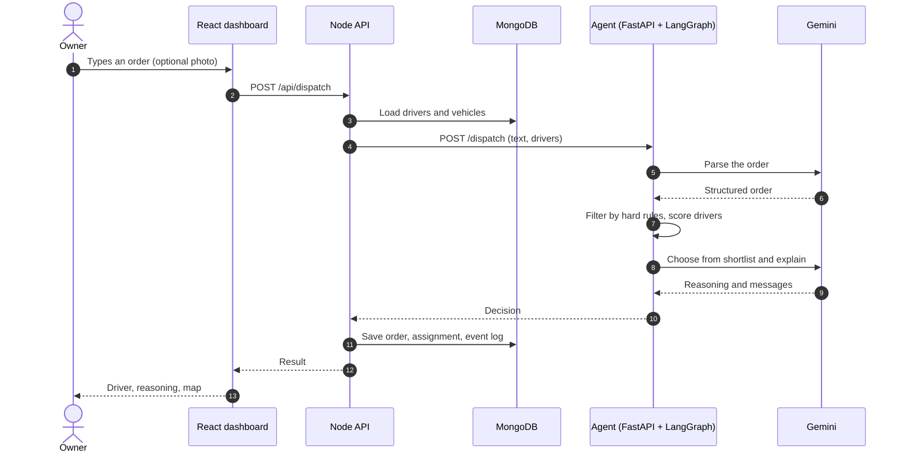

<p align="center">
  
</p>

<h1 align="center">RaastaSaathi</h1>

<p align="center">
  <strong>AI dispatch for small transport businesses.</strong><br/>
  Type an order the way a customer would say it. The agent picks the driver and vehicle, explains why, drafts the messages, and re-plans when things change.
</p>

<p align="center">
  
  
  
  
  
  
  
</p>

<p align="center">
  Built by <strong>[Team Name]</strong> for <strong>[Hackathon Name]</strong>
</p>

---

## Table of contents

- [The problem](#the-problem)
- [The solution](#the-solution)
- [Features and status](#features-and-status)
- [Demo walkthrough](#demo-walkthrough)
- [Architecture](#architecture)
- [How a decision is made](#how-a-decision-is-made)
- [Tech stack](#tech-stack)
- [Project structure](#project-structure)
- [Getting started](#getting-started)
- [Environment variables](#environment-variables)
- [API reference](#api-reference)
- [Data model](#data-model)
- [Simulation results](#simulation-results)
- [Testing](#testing)
- [Reliability and safety design](#reliability-and-safety-design)
- [Troubleshooting](#troubleshooting)
- [Limitations](#limitations)
- [Roadmap](#roadmap)
- [Team](#team)
- [Acknowledgements](#acknowledgements)

---

## The problem

Small transport operators, typically running 3 to 15 vehicles, dispatch work through phone calls, WhatsApp messages and a notebook. That leads to:

- The wrong truck for the load (too small, uncovered for a perishable load, no loading help)
- Idle vehicles next to jobs that go to someone far away
- A scramble whenever a driver cancels or an urgent order arrives
- Customers who are not told who is coming

Existing dispatch software is built for larger fleets with a dedicated dispatcher, GPS on every vehicle and a software budget. Small operators have phones and Hinglish.

## The solution

TruckSaathi turns a plain-language order into a justified assignment.

1. The owner or customer types an order in English, Hindi or Hinglish, optionally with a photo of the load.
2. The agent extracts pickup, drop, weight, handling needs and deadline.
3. Rules written in code remove every vehicle that cannot properly carry the load.
4. The remaining drivers are scored, and an AI model chooses from the shortlist and explains its choice in plain language.
5. Messages for the driver and the customer are drafted.
6. If a driver cancels, or an urgent order needs a driver who is on a normal job, the agent re-plans and explains the change.

> Example input: `kal subah 2 ton cement Noida se Gurgaon bhejna hai`

## Features and status

| Capability | Status |
|---|---|
| Free-text and Hinglish order parsing into structured jobs | Working |
| Hard-rule eligibility filter (capacity, cover, refrigeration, loading help) | Working, unit-tested |
| Driver ranking on distance, vehicle fit, rating and skills | Working, unit-tested |
| AI explanation of each decision, with a built-in fallback explanation | Working |
| Driver cancellation with automatic reassignment | Working |
| Dashboard with live map, fleet status, decision panel and event timeline | Working |
| Clarification request instead of guessing unknown or missing places | Working |
| Urgent order that moves a normal-priority job and re-plans it | Implemented, under testing |
| Photo of the load: rough classification and a weight sanity warning | Implemented, under testing |

<!-- Update the two "under testing" rows once you have tested them. -->

## Demo walkthrough

The dashboard has three columns: order input and fleet on the left, map and agent decision in the middle, event timeline on the right.

**1. Dispatch an order.** Pick a sample order or type your own and press **Dispatch**. The decision card shows the chosen driver and vehicle, the reasoning, the score breakdown, the drafted driver and customer messages, the other eligible drivers, and the drivers that were ruled out with reasons.

**2. A driver cancels.** Press the cancel button on the decision card. The driver is taken off duty, the agent re-plans with that driver excluded, and the reasoning names who dropped out and why the replacement was chosen.

**3. An urgent order arrives.** Type an order and press **Urgent**. If the best driver is on a normal-priority job that has not started, that job is moved to another driver and the dashboard shows what moved.

Use **Reset demo** to return to a clean state.

<!--
Add screenshots here once you have them, for example:


-->

## Architecture

<p align="center">
  
</p>

| Component | Responsibility |
|---|---|
| `client` | React dashboard: order input, map, decision panel, fleet and timeline |
| `server` | Node and Express API, MongoDB persistence, builds the driver list the agent needs |
| `agent` | Python FastAPI service running a LangGraph pipeline: parse, rank, decide, re-plan |
| MongoDB | Drivers, vehicles, orders, assignments and an event log |
| Gemini | Reads orders and photos, chooses from the shortlist and writes explanations |

The agent is stateless. The Node server sends it the order and the current drivers on every call, so the agent never touches the database and is easy to test on its own.

### Request flow



## How a decision is made

The central design rule: **code decides who is eligible, and the AI only chooses among eligible drivers and explains.** The model cannot assign a truck that cannot carry the load.

### Step 1: Parse

The model converts the message into a structured order (places, weight in kg, material, handling needs, priority, deadline). Place names are resolved to coordinates by a lookup table in code, never by the model, so a place is either recognised or flagged.

### Step 2: Photo check (optional)

If a photo is supplied, the model describes the visible goods and gives a rough weight band. If the stated weight is clearly outside that band, the dashboard shows a warning. The photo never changes the assignment on its own, and the weight band is an estimate.

### Step 3: Hard-rule filter

A driver is ruled out, with a stated reason, if any of these fail:

| Rule | Condition |
|---|---|
| Capacity | Load weight must not exceed vehicle capacity |
| Cover | Perishable loads and loads that need cover require a covered vehicle |
| Refrigeration | Loads that need refrigeration require a refrigerated vehicle |
| Loading help | Loads that need a loader require a vehicle with a loader or a driver with loading skills |
| Availability | The driver must be available, and not the driver who just cancelled |

### Step 4: Score

Eligible drivers receive a score out of 100:

| Component | Max | What it measures |
|---|---|---|
| Proximity | 40 | Estimated road distance to pickup (straight-line distance times 1.3). Zero beyond 60 km |
| Vehicle fit | 25 | Load weight against capacity. Best when the vehicle is 50% to 95% full. Oversized and very tight fits score lower. Unknown weight scores neutral |
| Rating | 15 | Driver rating out of 5 |
| Skills | 20 | Match between required handling (fragile, perishable, loading help, heavy loads of 2,000 kg or more) and the driver's skills. Neutral when nothing special is required |

These weights are a heuristic starting point and have not been tuned against real data.

### Step 5: Choose and explain

The model sees only the top candidates within 8 points of the best score (at most three), plus the other eligible drivers and the ruled-out drivers with reasons. It must pick one of the shortlisted drivers. If it returns an invalid choice or the call fails, the highest-scoring driver is used with a built-in explanation, and the dashboard labels it as a fallback explanation.

### Re-planning

- **Driver cancels.** The driver is set off duty, the assignment is marked cancelled, and the same pipeline runs again with that driver excluded. The reasoning names who dropped out.
- **Urgent order.** Drivers who are on a normal-priority job that has not started become candidates with a 15-point penalty, so a driver is moved only when clearly the best fit. The displaced job is then re-planned onto another driver.

## Tech stack

| Layer | Technology |
|---|---|
| Frontend | React, Vite, Tailwind CSS v4, Leaflet with OpenStreetMap tiles, Axios |
| Backend | Node.js 20+, Express, Mongoose |
| Database | MongoDB (Atlas or local) |
| Agent | Python 3.11+, FastAPI, LangGraph, LangChain, Pydantic |
| AI model | Google Gemini through `langchain-google-genai` |
| Testing | pytest |

## Project structure

```text
ai-dispatcher/
├── README.md
├── .gitignore
├── docs/
│   └── architecture.png
│
├── client/                          # React dashboard (Vite + Tailwind)
│   ├── index.html
│   ├── package.json
│   ├── vite.config.js               # Tailwind plugin and /api proxy to the server
│   ├── public/
│   │   └── logo.png
│   └── src/
│       ├── main.jsx
│       ├── App.jsx
│       ├── api/
│       │   ├── client.js            # Axios instance
│       │   └── dispatch.js          # dispatch, cancel, urgent, reset, drivers, events
│       ├── pages/
│       │   └── Dashboard.jsx
│       ├── components/
│       │   ├── agent/               # DecisionPanel, EventTimeline
│       │   ├── drivers/             # DriverList, StatsStrip
│       │   ├── map/                 # LiveMap
│       │   ├── orders/              # OrderForm (text, photo, urgent)
│       │   └── ui/                  # Card, Badge
│       └── styles/
│           └── app.css              # Tailwind entry
│
├── server/                          # Node + Express + MongoDB
│   ├── package.json
│   ├── .env.example
│   └── src/
│       ├── index.js                 # entry point
│       ├── app.js                   # Express setup and routes
│       ├── config/                  # db.js, env.js
│       ├── models/                  # Driver, Vehicle, Order, Assignment, EventLog
│       ├── routes/                  # drivers, orders, dispatch, disruption
│       ├── controllers/             # drivers, orders, dispatch, disruption
│       ├── services/
│       │   ├── agentClient.js       # calls the Python agent
│       │   ├── candidateService.js  # builds the driver list sent to the agent
│       │   └── assignmentService.js # saves an assignment and updates statuses
│       └── seed/                    # seed.js, drivers.json, vehicles.json, orders.json
│
└── agent/                           # Python + FastAPI + LangGraph
    ├── requirements.txt
    ├── .env.example
    ├── simulate.py                  # offline strategy comparison (no AI model)
    ├── app/
    │   ├── main.py                  # FastAPI app
    │   ├── config.py                # loads agent/.env
    │   ├── graph/
    │   │   ├── state.py             # shared graph state
    │   │   ├── builder.py           # nodes and conditional edges
    │   │   └── nodes/               # parse_order, analyze_image, score_candidates, decide
    │   ├── tools/                   # plain code: distance, capacity, scoring, geo
    │   ├── llm/
    │   │   ├── client.py            # model setup
    │   │   └── prompts/             # parse_order, analyze_image, decide
    │   ├── schemas/                 # order.py, decision.py (Pydantic)
    │   ├── routers/                 # health, parse, dispatch, replan
    │   └── fallback/
    │       └── cached_parses.json   # parses used when the model call fails
    └── tests/
        └── test_scoring.py
```

## Getting started

### Prerequisites

- Node.js 20 or newer (required by Tailwind v4)
- Python 3.11 or newer
- A MongoDB connection string (a free MongoDB Atlas cluster works)
- A Gemini API key from Google AI Studio

### 1. Clone

```powershell
git clone https://github.com/<your-username>/<repo-name>.git
cd <repo-name>
```

### 2. Server

```powershell
cd server
npm install
copy .env.example .env      # then fill in MONGO_URI
npm run seed                # creates 8 vehicles, 8 drivers and sample orders
cd ..
```

### 3. Agent

```powershell
cd agent
python -m venv venv
.\venv\Scripts\Activate.ps1
pip install -r requirements.txt
copy .env.example .env      # then fill in GOOGLE_API_KEY and GEMINI_MODEL
cd ..
```

### 4. Client

```powershell
cd client
npm install
cd ..
```

### 5. Run (three terminals)

```powershell
# Terminal 1: API on :5000
cd server
node src/index.js

# Terminal 2: agent on :8000
cd agent
.\venv\Scripts\Activate.ps1
uvicorn app.main:app --reload-dir app --port 8000

# Terminal 3: dashboard on :5173
cd client
npm run dev
```

Open <http://localhost:5173>.

<details>
<summary>macOS and Linux</summary>

```bash
cp .env.example .env                # in server and in agent
source venv/bin/activate            # instead of .\venv\Scripts\Activate.ps1
```

</details>

### Before you push to GitHub

Make sure `.gitignore` includes `.env`, `node_modules`, `venv` and `__pycache__`. Never commit API keys or connection strings.

## Environment variables

**`server/.env`**

| Variable | Description | Example |
|---|---|---|
| `PORT` | API port | `5000` |
| `MONGO_URI` | MongoDB connection string | `mongodb+srv://<user>:<password>@<cluster>.mongodb.net/ai-dispatcher` |
| `AGENT_URL` | Where the agent is running | `http://127.0.0.1:8000` |

**`agent/.env`**

| Variable | Description | Example |
|---|---|---|
| `GOOGLE_API_KEY` | Gemini API key | `your_key_here` |
| `GEMINI_MODEL` | Model name. Check Google AI Studio for a currently available model | `gemini-3.8-flash` |

Model names are retired from time to time, and free-tier request limits are low and change over time. Check current limits before a demo.

## API reference

### Node API (`http://localhost:5000`)

| Method | Path | Body | Description |
|---|---|---|---|
| GET | `/api/health` | | Health check |
| GET | `/api/drivers` | | List drivers with their vehicles |
| PATCH | `/api/drivers/:id/status` | `{ "status": "available" }` | Set a driver to `available`, `busy` or `off_duty` |
| GET | `/api/orders` | | List orders |
| POST | `/api/orders` | order fields | Create an order directly |
| POST | `/api/dispatch` | `{ "rawText", "customerName"?, "imageBase64"? }` | Parse, assign and save an order |
| GET | `/api/dispatch/assignments` | | Active assignments |
| GET | `/api/dispatch/events` | | Latest 50 events |
| POST | `/api/disruption/cancel` | `{ "orderId", "reason"? }` | Driver cancels, agent reassigns |
| POST | `/api/disruption/urgent` | `{ "rawText", "customerName"?, "imageBase64"? }` | Urgent order, may move a normal-priority job |
| POST | `/api/disruption/reset` | | Demo only: clears orders, assignments and events and frees all drivers |

`POST /api/dispatch` returns one of these `status` values: `assigned`, `needs_clarification` (pickup or drop missing or unrecognised) or `no_candidates` (every driver ruled out).

Example (trimmed, values are illustrative):

```json
{
  "status": "assigned",
  "order": { "rawText": "…", "pickup": { "label": "…", "lat": 28.4, "lng": 77.3 }, "priority": "normal" },
  "decision": {
    "driver_id": "…",
    "name": "…",
    "vehicle_plate": "…",
    "score": 82.5,
    "breakdown": { "proximity": 34.0, "capacity_fit": 25.0, "rating": 13.5, "skills": 10.0 },
    "reasoning": "…",
    "driverMessage": "…",
    "customerMessage": "…",
    "alternatives": [{ "driver_id": "…", "name": "…", "score": 71.2 }],
    "rejected": [{ "driver_id": "…", "name": "…", "reasons": ["load needs a covered vehicle"] }],
    "source": "llm",
    "llmError": null
  }
}
```

`source` is `llm` when the model wrote the explanation and `fallback` when the built-in explanation was used.

### Agent API (`http://localhost:8000`)

| Method | Path | Body | Description |
|---|---|---|---|
| GET | `/health` | | Health check |
| POST | `/parse` | `{ "rawText" }` | Parse an order only |
| POST | `/dispatch` | `{ "rawText" or "order", "drivers", "excludeDriverIds"?, "imageBase64"? }` | Run the full pipeline |
| POST | `/replan` | `{ "order", "drivers", "cancelledDriverId", "reason"? }` | Re-run with a driver excluded |

## Data model

| Collection | Key fields |
|---|---|
| `drivers` | name, phone, location (label, lat, lng), status, rating, skills, vehicle |
| `vehicles` | plate, type, capacityKg, covered, refrigerated, hasLoader |
| `orders` | rawText, pickup, drop, load (material, weightKg, handling, photo analysis), deadline, priority, status |
| `assignments` | order, driver, vehicle, score, score breakdown, reasoning, messages, alternatives, status |
| `eventlogs` | type, order, driver, message, metadata |

## Simulation results

`agent/simulate.py` compares three strategies on 500 synthetic orders against the 8-driver demo fleet. Each driver is free with probability 0.7 per trial, and the random seed is fixed so results are reproducible. It uses no AI model.

```powershell
cd agent
python simulate.py
```

| Strategy | Wrong truck | Left unassigned | Avg pickup (km) | Oversized |
|---|---|---|---|---|
| First free driver | 68.4% | 0% | 36.7* | 19.4%* |
| Nearest eligible driver | 0.0% | 13.2% | 26.9 | 61.8% |
| TruckSaathi ranking | 0.0% | 13.2% | 30.6 | 46.3% |

- **Wrong truck:** the vehicle cannot carry the load or lacks the required cover, refrigeration or loading help, under the rules above.
- **Left unassigned:** no free vehicle could properly carry the load, so the job is held instead of sent to the wrong truck.
- **Oversized:** vehicle capacity is more than three times the load weight.
- \* The first-free-driver figures include assignments the rules would reject.

How to read this: applying the eligibility rules removes wrong-truck assignments in the simulation. Compared with simply choosing the nearest eligible driver, the ranking accepts about 14% longer pickups in exchange for fewer oversized vehicles, and that trade-off is adjustable through the scoring weights. The orders and fleet are synthetic, the "wrong truck" definition comes from this project's own rules, and the 3x oversize threshold is arbitrary. This shows the logic behaves sensibly. It is not a measurement of real-world savings.

## Testing

```powershell
cd agent
.\venv\Scripts\Activate.ps1
python -m pytest -q
```

The unit tests cover the eligibility rules and ranking, with no AI model involved. The server and dashboard were tested manually end to end.

## Reliability and safety design

- **Rules are code, not prompts.** The AI model never sees an ineligible driver as a choice, and it may only pick from the shortlist.
- **No invented locations.** Places are resolved from a lookup table. An unknown or missing pickup or drop returns a clarification request instead of a guess.
- **Graceful degradation.** If the model call fails or returns an invalid choice, the best-scored driver is still assigned with a built-in explanation, and the dashboard labels it. Sample orders also have cached parses.
- **Honest uncertainty.** Photo analysis reports a coarse weight band and a confidence level. A mismatch produces a warning to confirm with the customer, not an override.
- **Grounded explanations.** The model is given the figures it may cite (distance, capacity, rating, skills) and the reasons drivers were ruled out.

## Troubleshooting

| Symptom | Likely cause and fix |
|---|---|
| `404 NOT_FOUND` for the model | `GEMINI_MODEL` names a retired model. Update it in `agent/.env` and restart the agent |
| `429 RESOURCE_EXHAUSTED` | Free-tier daily quota used up. Wait for the reset. Orders still get assigned with the fallback explanation |
| `API key required` | `GOOGLE_API_KEY` is missing or `agent/.env` is not being read. Check the file name and variable name |
| Dashboard shows a network error | The Node server is not running, or Vite was not restarted after changing `vite.config.js` |
| Page has no styling | Tailwind plugin missing from `vite.config.js`, or `src/styles/app.css` does not contain `@import "tailwindcss";` |
| Requests drop mid-way on Windows | A file watcher restarted the server. Run `node src/index.js` and `uvicorn` without auto-reload, and avoid OneDrive-synced folders |
| `MissingSchemaError` | A model that uses `ref` must import the referenced model file |

## Limitations

- Distances are straight-line estimates with a road factor, not real routes. Map lines are previews.
- Locations come from a small fixed table of Delhi NCR places.
- The fleet and orders are simulated, and there is no live GPS or driver app.
- Scoring weights are heuristic and untuned.
- Moving a normal-priority job for an urgent order applies only to jobs that have not started. The system does not track a driver already on the road.
- Photo weight is a rough band and can be wrong, depending on angle, scale and lighting.
- Free-tier model limits are low, and model names change over time.

## Roadmap

- Real road routing and travel-time estimates
- WhatsApp and Telegram notifications to drivers and customers
- A simple driver app with one-tap accept and decline
- Voice orders
- Importing a real fleet from a spreadsheet and adding drivers in the dashboard
- Live driver location
- Tuning scoring weights from real dispatch history
- Validation with real transport operators


## Acknowledgements

Map data © [OpenStreetMap](https://www.openstreetmap.org/copyright) contributors. Maps rendered with [Leaflet](https://leafletjs.com/).